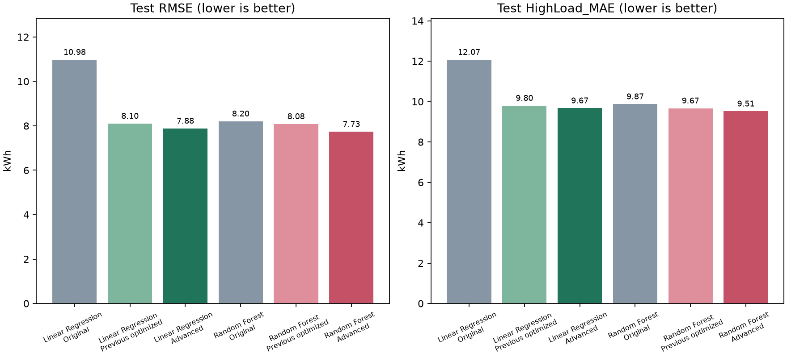

# Advanced Training: Linear Regression and Random Forest

Only these two models were developed and trained. The friend's SVR files were not changed or trained. Earlier outputs and notebooks remain available. These are the best configurations among the evaluated five-fold finalists, not a guarantee of global optimality or best performance on every metric.

## Common Cross-Validation Comparison

TimeSeriesSplit(n_splits=5) uses the same 28,511 chronologically ordered training rows and fold boundaries as the supplied SVR notebook's five-fold reporting stage. Candidates first screen on the last two folds; finalists and the previous optimized configuration are evaluated on all five. The lowest mean fold RMSE selects the configuration. MAE, R2 and high-load MAE are recorded, not silently substituted as the selection objective.

| Model | Version | Mean CV RMSE | Mean CV MAE | Mean CV HighLoad_MAE | Fold RMSE SD |
| --- | --- | --- | --- | --- | --- |
| Linear Regression | Previous settings | 10.3075 | 5.4257 | 12.7966 | 1.6175 |
| Linear Regression | Selected settings | 9.9122 | 5.1683 | 12.3444 | 1.0799 |
| Random Forest | Previous settings | 9.8971 | 4.8113 | 11.9061 | 0.9697 |
| Random Forest | Selected settings | 9.6412 | 4.6342 | 11.9941 | 0.8612 |

The five-fold mean is a tuning score, not an unbiased independent estimate: candidate selection is not nested. Earlier feature choices were informed by the supplied full training period. No model is selected using this run's test scores.

## Final Test Comparison

| Model | Version | MAE | RMSE | R2 | HighLoad_MAE |
| --- | --- | --- | --- | --- | --- |
| Linear Regression | Original | 6.2970 | 10.9755 | 0.8757 | 12.0705 |
| Linear Regression | Previous optimized | 4.2966 | 8.0980 | 0.9323 | 9.7950 |
| Linear Regression | Advanced | 4.1277 | 7.8803 | 0.9359 | 9.6712 |
| Random Forest | Original | 3.8474 | 8.2043 | 0.9306 | 9.8719 |
| Random Forest | Previous optimized | 3.8393 | 8.0826 | 0.9326 | 9.6668 |
| Random Forest | Advanced | 3.6445 | 7.7350 | 0.9383 | 9.5150 |



All test comparisons use the same 5,857 target timestamps and input artifacts. HighLoad_MAE uses actual Usage_kWh >= 50, exactly as the friend's notebook. These are 15-minute one-step forecasts with earlier actual readings available. R2 is not percentage accuracy. A configuration that wins cross-validation can still have a worse test metric; report that honestly rather than choosing another configuration by test score.

## What Was Investigated

- LinearRegression: spline knot count/spacing/degree, quarter-hour and weekend interactions, additional change features, removing load_level, higher fitting weights for high-load examples, and recency weighting. The learner remains ordinary or weighted least squares according to the selected configuration.
- RandomForestRegressor: depth, feature fraction, leaf/split sizes, bootstrap sample fraction, number of trees, schedule features, removing load_level, fit-only weights, and direct versus change prediction. A change model adds lag_1 back before clipping to zero.
- Random Forest finalists use 400 trees, followed by 1,000-tree checks for the two best new finalists. The previous 800-tree configuration is always a full-CV candidate. Increasing tree count is an experiment, not an automatic improvement.
- No Ridge, Lasso, boosting, SVR or cross-family ensemble is substituted for the assigned learners.

## Linear Regression

Screened 37 configurations on the last two CV folds, then evaluated 9 finalists on all five folds. Selected `{"knots": 5, "schedule": "weekend", "use_load": false}`. The final fit uses 28,511 rows and 651 engineered columns.

Cross-validation trade-offs versus the previous settings: RMSE_kWh: 10.3075 to 9.9122 (lower); MAE_kWh: 5.4257 to 5.1683 (lower); HighLoad_MAE: 12.7966 to 12.3444 (lower). RMSE is the selection objective; a worse secondary metric is retained and disclosed.

This model learns Usage_kWh directly and floors predictions at zero.

| model | split | n_rows | MAE_kWh | RMSE_kWh | R2 | HighLoad_MAE | high_load_rows |
| --- | --- | --- | --- | --- | --- | --- | --- |
| Linear Regression | cv_mean | 23755 | 5.1683 | 9.9122 | 0.9017 | 12.3444 | N/A |
| Linear Regression | cv_pooled | 23755 | 5.1683 | 9.9709 | 0.9015 | 12.3997 | 5698.0000 |
| Persistence | cv_pooled | 23755 | 6.0622 | 13.5127 | 0.8191 | 15.6042 | 5698.0000 |
| Linear Regression | train | 28511 | 4.9843 | 9.5824 | 0.9191 | 12.1062 | 7443.0000 |
| Linear Regression | test | 5857 | 4.1277 | 7.8803 | 0.9359 | 9.6712 | 1491.0000 |
| Persistence | test | 5857 | 5.1552 | 11.8125 | 0.8560 | 12.4196 | 1491.0000 |

Finalists (same five folds):

| RMSE_kWh | MAE_kWh | HighLoad_MAE | RMSE_std | specification |
| --- | --- | --- | --- | --- |
| 9.9122 | 5.1683 | 12.3444 | 1.0799 | {"knots": 5, "schedule": "weekend", "use_load": false} |
| 9.9387 | 5.1543 | 12.3653 | 1.1369 | {"knot_spacing": "uniform", "knots": 5, "schedule": "weekend"} |
| 9.9398 | 5.2371 | 12.3710 | 1.1252 | {"knots": 8, "schedule": "weekend", "use_load": false} |
| 10.0597 | 5.2408 | 12.6357 | 1.3341 | {"degree": 2, "knots": 5, "schedule": "weekend"} |
| 10.1269 | 5.2891 | 12.7474 | 1.5003 | {"knots": 5, "schedule": "weekend", "use_load": true} |
| 10.2425 | 5.3331 | 12.9784 | 1.7816 | {"half_life_days": 120, "knots": 5, "schedule": "weekend"} |
| 10.3030 | 5.4350 | 13.0236 | 1.8347 | {"knots": 8, "schedule": "weekend", "use_load": true} |
| 10.3075 | 5.4257 | 12.7966 | 1.6175 | {"previous": {"basis": "spline", "feature_mode": "time96", "knots": 5}} |
| 10.4174 | 5.4212 | 13.2861 | 2.0897 | {"half_life_days": 60, "knots": 5, "schedule": "weekend"} |

Sensitivity excluding the known interpolated answer and its dependent lag/rolling rows:

| model | split | n_rows | MAE_kWh | RMSE_kWh | R2 | HighLoad_MAE | high_load_rows |
| --- | --- | --- | --- | --- | --- | --- | --- |
| Selected configuration | exclude_interpolation_influence | 5759 | 4.1078 | 7.8551 | 0.9363 | 9.6868 | 1453 |

Last-fold sensitivity when ignoring load_level (identical setting if already ignored):

| model | split | n_rows | MAE_kWh | RMSE_kWh | R2 | HighLoad_MAE | high_load_rows |
| --- | --- | --- | --- | --- | --- | --- | --- |
| Selected settings without load_level | last_cv_fold | 4751 | 4.5877 | 9.1441 | 0.9115 | 11.6778 | 1068 |

Model export and timing:

```json
{
  "reload_predictions_match": true,
  "fitted_on_rows": 28511,
  "test_rows": 5857,
  "prediction_seconds_96_rows": 0.021095208008773625,
  "model_size_bytes": 29232,
  "model_sha256": "a46b9b84fc803505b6bc0581b77f0e0ff2e0ae50509f871d7af60aef02b4edcf",
  "source_sha256": "be3de3fa63f5f9cabce925b04dd21a0efeac34de0fafa268bc72e17e6e660ff8",
  "load_level_independence_verified": true,
  "compressed_reload_verified": true
}
```

## Random Forest

Screened 53 configurations on the last two CV folds, then evaluated 9 finalists on all five folds. Selected `{"half_life_days": null, "high_weight": 1.0, "max_depth": null, "max_features": 0.6, "max_samples": null, "min_samples_leaf": 2, "min_samples_split": 2, "n_estimators": 1000, "schedule": "harmonics", "target_mode": "delta", "use_load": false}`. The final fit uses 28,511 rows and 70 engineered columns.

Cross-validation trade-offs versus the previous settings: RMSE_kWh: 9.8971 to 9.6412 (lower); MAE_kWh: 4.8113 to 4.6342 (lower); HighLoad_MAE: 11.9061 to 11.9941 (higher). RMSE is the selection objective; a worse secondary metric is retained and disclosed.

This forest learns Usage_kWh minus lag_1. Its saved prediction method adds lag_1 back, then floors the result at zero. Feature importance describes tree splits for the change target.

| model | split | n_rows | MAE_kWh | RMSE_kWh | R2 | HighLoad_MAE | high_load_rows |
| --- | --- | --- | --- | --- | --- | --- | --- |
| Random Forest Regression | cv_mean | 23755 | 4.6342 | 9.6412 | 0.9075 | 11.9941 | N/A |
| Random Forest Regression | cv_pooled | 23755 | 4.6342 | 9.6796 | 0.9072 | 12.0400 | 5698.0000 |
| Persistence | cv_pooled | 23755 | 6.0622 | 13.5127 | 0.8191 | 15.6042 | 5698.0000 |
| Random Forest Regression | train | 28511 | 1.9454 | 4.2634 | 0.9840 | 5.0573 | 7443.0000 |
| Random Forest Regression | test | 5857 | 3.6445 | 7.7350 | 0.9383 | 9.5150 | 1491.0000 |
| Persistence | test | 5857 | 5.1552 | 11.8125 | 0.8560 | 12.4196 | 1491.0000 |

Finalists (same five folds):

| RMSE_kWh | MAE_kWh | HighLoad_MAE | RMSE_std | specification |
| --- | --- | --- | --- | --- |
| 9.6412 | 4.6342 | 11.9941 | 0.8612 | {"half_life_days": null, "high_weight": 1.0, "max_depth": null, "max_features": 0.6, "max_samples": null, "min_samples_leaf": 2, "min_samples_split": 2, "n_estimators": 1000, "schedule": "harmonics", "target_mode": "delta", "use_load": false} |
| 9.6600 | 4.6465 | 12.0151 | 0.8623 | {"half_life_days": null, "high_weight": 1.0, "max_depth": null, "max_features": 0.6, "max_samples": null, "min_samples_leaf": 2, "min_samples_split": 2, "n_estimators": 400, "schedule": "harmonics", "target_mode": "delta", "use_load": false} |
| 9.7330 | 4.6746 | 12.0607 | 0.9087 | {"half_life_days": 90, "high_weight": 1.0, "max_depth": null, "max_features": 1.0, "max_samples": null, "min_samples_leaf": 2, "min_samples_split": 20, "n_estimators": 400, "schedule": "harmonics", "target_mode": "delta", "use_load": false} |
| 9.7334 | 4.6749 | 12.0621 | 0.9150 | {"half_life_days": 90, "high_weight": 1.0, "max_depth": null, "max_features": 1.0, "max_samples": null, "min_samples_leaf": 2, "min_samples_split": 20, "n_estimators": 1000, "schedule": "harmonics", "target_mode": "delta", "use_load": false} |
| 9.7384 | 4.6902 | 11.9009 | 0.9099 | {"half_life_days": 90, "high_weight": 1.3, "max_depth": null, "max_features": 0.35, "max_samples": null, "min_samples_leaf": 4, "min_samples_split": 20, "n_estimators": 400, "schedule": "harmonics", "target_mode": "delta", "use_load": false} |
| 9.8708 | 4.7586 | 11.9006 | 1.0654 | {"half_life_days": 90, "high_weight": 1.3, "max_depth": null, "max_features": 0.6, "max_samples": null, "min_samples_leaf": 4, "min_samples_split": 2, "n_estimators": 400, "schedule": "harmonics", "target_mode": "level", "use_load": true} |
| 9.8971 | 4.8113 | 11.9061 | 0.9697 | {"previous": {"feature_mode": "context", "max_depth": 12, "max_features": 0.4, "max_samples": null, "min_samples_leaf": 1, "min_samples_split": 10, "n_estimators": 800}} |
| 9.9075 | 4.8295 | 11.8260 | 1.0367 | {"half_life_days": null, "high_weight": 1.3, "max_depth": 12, "max_features": 0.35, "max_samples": null, "min_samples_leaf": 2, "min_samples_split": 2, "n_estimators": 400, "schedule": "harmonics", "target_mode": "level", "use_load": false} |
| 9.9438 | 4.7909 | 11.9589 | 1.1021 | {"half_life_days": null, "high_weight": 1.0, "max_depth": 12, "max_features": 0.6, "max_samples": 0.7, "min_samples_leaf": 8, "min_samples_split": 20, "n_estimators": 400, "schedule": "harmonics", "target_mode": "level", "use_load": true} |

Sensitivity excluding the known interpolated answer and its dependent lag/rolling rows:

| model | split | n_rows | MAE_kWh | RMSE_kWh | R2 | HighLoad_MAE | high_load_rows |
| --- | --- | --- | --- | --- | --- | --- | --- |
| Selected configuration | exclude_interpolation_influence | 5759 | 3.6308 | 7.7180 | 0.9385 | 9.5480 | 1453 |

Last-fold sensitivity when ignoring load_level (identical setting if already ignored):

| model | split | n_rows | MAE_kWh | RMSE_kWh | R2 | HighLoad_MAE | high_load_rows |
| --- | --- | --- | --- | --- | --- | --- | --- |
| Selected settings without load_level | last_cv_fold | 4751 | 4.1201 | 8.9341 | 0.9155 | 11.3576 | 1068 |

Model export and timing:

```json
{
  "reload_predictions_match": true,
  "fitted_on_rows": 28511,
  "test_rows": 5857,
  "prediction_seconds_96_rows": 0.08198904199525714,
  "model_size_bytes": 326280729,
  "model_sha256": "861284d63c80b31af840333e893d92f7f3906ebe86633edfa2213e3f8d1257a2",
  "source_sha256": "496c6c47789db332fc1397e9d3eb7619ddf24c141b58676e7855460ff192e510",
  "load_level_independence_verified": true,
  "compressed_reload_verified": true
}
```

## Data and Interpretation Limits

- Forecasts are one interval ahead (15 minutes), with previous actual readings available before each prediction. This is not a day-ahead test.
- The supplied preprocessing shifts midnight rows to the next day; the original interval timestamp convention remains an assumption.
- The supplied preprocessing interpolates the target at 2018-11-08 00:00 using a future reading. This affects that test target and later lag/rolling features. Test results describe those supplied artifacts, not a fully causal evaluation of raw measurements.
- Upstream feature selection used the entire supplied training period, including September/October. Validation is provisional conditional on that fixed feature set; strict validation needs feature selection refitted on the earlier fitting period.
- The preprocessing notebook already inspected the test persistence score and full-dataset EDA. Do not describe the test set as completely untouched.

- Both previous test results were already seen before this request. The project has no fresh untouched future holdout; independent confirmation needs new chronological observations.
- The known imputed reading and all 98 directly affected answer/feature rows are excluded in a separate sensitivity table. This table does not establish that the full supplied preprocessing is causal.
- If a selected configuration omits load_level, its 15-column input contract remains unchanged but the transformer ignores that column. A finite placeholder can fill that field when unavailable. Other selected configurations require the load category to be known in advance.
- Hyperparameter search is finite and can overfit validation. The final fitted artifact is not trained on test targets.
- These artifacts are models and experiment evidence. They do not implement the complete raw-meter backend, frontend, or guarantee an assessment outcome.

## Files and Commands

Each model's `outputs_advanced` directory contains model.joblib, metrics.csv, validation_trials.csv, cv_fold_trials.csv, fold_boundaries.csv, validation_predictions.csv, test_predictions.csv, evaluation.png, feature_effects.csv, selected_configuration.json, search_protocol.json, interpolation_sensitivity.csv, load_level_ablation.csv and verification.json. The executed `advanced_walkthrough.ipynb` is the current walkthrough; `optimized_walkthrough.ipynb` documents the previous experiment.

Show results without training:

```bash
.venv/bin/python src/show_model_results.py
```

Repeat advanced training only when needed:

```bash
.venv/bin/python src/advanced_training.py --model linear --train
.venv/bin/python src/advanced_training.py --model forest --train
.venv/bin/python src/build_advanced_report.py
```

For prediction, use src/predict_regression.py with the selected outputs_advanced/model.joblib and the same prepared 15-column CSV schema. Retain the src package with the model files. All preprocessing, target handling and nonnegative clipping are included in the saved estimator.

The group's final selection still requires all five algorithms on an agreed validation protocol and documentation of their test results. Do not mix the previous single September-October validation score with the new five-fold mean.
