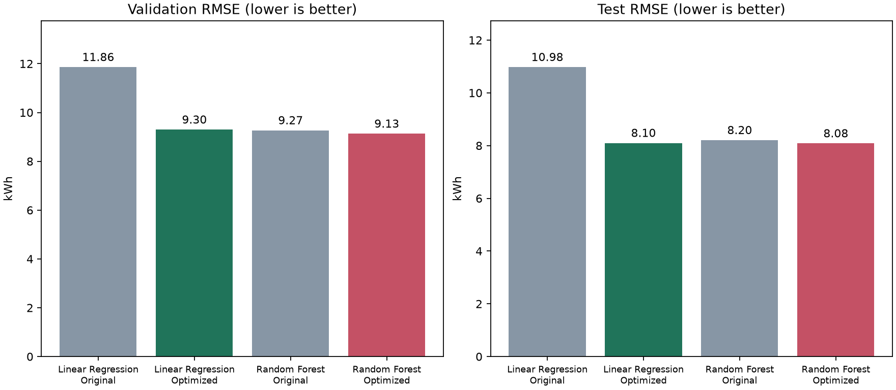

# Model Optimization: Progress Evaluation 2

Both models are trained and verified. This report covers the user's two models, not the group's final five-model selection. Passing the individual viva also requires understanding and explaining the work.

## Results

Linear Regression here means ordinary least squares with the selected engineered features and a nonnegative prediction floor. It is not a claim that plain linear regression on the original 15 columns achieved the optimized scores. Random Forest also uses its selected feature representation.

| Model | Version | Split | MAE (kWh) | RMSE (kWh) | R2 |
| --- | --- | --- | --- | --- | --- |
| Linear Regression | Original | validation | 6.5989 | 11.8586 | 0.8557 |
| Linear Regression | Original | test | 6.2970 | 10.9755 | 0.8757 |
| Linear Regression | Optimized | validation | 4.7516 | 9.2957 | 0.9113 |
| Linear Regression | Optimized | test | 4.2966 | 8.0980 | 0.9323 |
| Random Forest | Original | validation | 4.2768 | 9.2667 | 0.9119 |
| Random Forest | Original | test | 3.8474 | 8.2043 | 0.9306 |
| Random Forest | Optimized | validation | 4.2543 | 9.1287 | 0.9145 |
| Random Forest | Optimized | test | 3.8393 | 8.0826 | 0.9326 |

Based on the agreed validation RMSE, the preferred model among these two is **Random Forest**. Compare all five models on the same dates, targets and information before selecting the group winner. Test scores must not drive further tuning.



## What Was Optimized

Linear Regression: 18 candidate input representations; selected `{"basis": "spline", "feature_mode": "time96", "knots": 5}`. The final estimator is scikit-learn LinearRegression (ordinary least squares), with 461 transformed input columns. Time-specific lag interactions let the relationship between recent usage and the prediction depend on the quarter-hour. Spline basis functions allow smooth curved relationships while coefficients are still learned by least squares. Scaling and spline knots are fitted using fitting rows only. Negative predictions are floored at zero because energy consumption is nonnegative. The original unmodified linear baseline remains in `linear regression/outputs`.

Random Forest: 46 candidates. The search includes the original selected configuration, a deterministic randomized search, and 400/800-tree refinements of four promising configurations. Selected `{"feature_mode": "context", "max_depth": 12, "max_features": 0.4, "max_samples": null, "min_samples_leaf": 1, "min_samples_split": 10, "n_estimators": 800}`. It remains a RandomForestRegressor. The original trained forest remains in `random forest/outputs`.

Engineered features reuse the original 15 inputs. Reconstructed lag_2 = lag_1 - diff_1; reconstructed lag_3 = 4 * roll_mean_4 - lag_1 - lag_2 - lag_4. These formulas only use previous observations already represented in the input row. No new current-interval electrical measurement or target is added.

These are bounded searches. More training cannot guarantee the best possible model or first place among the team's algorithms. No Ridge, Lasso or other algorithm is silently renamed Linear Regression.

## Validation and Training

1. Fit candidates on 22,655 January-August rows.
2. Select using RMSE on the same 5,856 September-October rows for both models. The saved selection file is written before final test evaluation.
3. Run retrospective walk-forward diagnostics on May-June and July-August. These do not select another winner and are not independent estimates because settings were selected using later data.
4. Refit the selected configuration on all 28,511 January-October training rows.
5. Evaluate on 5,857 November onward test rows. Earlier actual readings are available for each one-step prediction.
6. Reload the saved models and independently recompute their predictions and metrics.

Training on the test answers would remove the meaningful separation between fitting and evaluation. These saved evaluation models deliberately use all training rows, not test targets. R2 is not percentage accuracy. RMSE and MAE are in kWh.

## Baselines and Additional Evidence

### Linear Regression

| model | split | n_rows | MAE_kWh | RMSE_kWh | R2 |
| --- | --- | --- | --- | --- | --- |
| Linear Regression | validation | 5856 | 4.7516 | 9.2957 | 0.9113 |
| Persistence | validation | 5856 | 5.8269 | 12.9605 | 0.8276 |
| Linear Regression | train | 28511 | 5.1821 | 9.7943 | 0.9154 |
| Linear Regression | test | 5857 | 4.2966 | 8.0980 | 0.9323 |
| Persistence | test | 5857 | 5.1552 | 11.8125 | 0.8560 |

Retrospective walk-forward diagnostics:

| model | split | n_rows | MAE_kWh | RMSE_kWh | R2 | fit_rows | validation_end_exclusive |
| --- | --- | --- | --- | --- | --- | --- | --- |
| Selected configuration | 2018-05 | 5856 | 5.2019 | 9.7669 | 0.9058 | 10847 | 2018-07-01 |
| Persistence | 2018-05 | 5856 | 5.9526 | 13.5429 | 0.8188 | 10847 | 2018-07-01 |
| Selected configuration | 2018-07 | 5952 | 4.7343 | 9.1913 | 0.9141 | 16703 | 2018-09-01 |
| Persistence | 2018-07 | 5952 | 5.8345 | 13.0442 | 0.8270 | 16703 | 2018-09-01 |
| Linear Regression | validation | 5856 | 4.7516 | 9.2957 | 0.9113 | 22655 | 2018-11-01 |
| Persistence | validation | 5856 | 5.8269 | 12.9605 | 0.8276 | 22655 | 2018-11-01 |

Removing the assumed-known load category, with the same selected settings:

| model | split | n_rows | MAE_kWh | RMSE_kWh | R2 |
| --- | --- | --- | --- | --- | --- |
| Selected, includes load_level | validation | 5856 | 4.7516 | 9.2957 | 0.9113 |
| Selected, without load_level | validation | 5856 | 4.7511 | 9.3030 | 0.9112 |

### Random Forest

| model | split | n_rows | MAE_kWh | RMSE_kWh | R2 |
| --- | --- | --- | --- | --- | --- |
| Random Forest Regression | validation | 5856 | 4.2543 | 9.1287 | 0.9145 |
| Persistence | validation | 5856 | 5.8269 | 12.9605 | 0.8276 |
| Random Forest Regression | train | 28511 | 3.6196 | 7.3856 | 0.9519 |
| Random Forest Regression | test | 5857 | 3.8393 | 8.0826 | 0.9326 |
| Persistence | test | 5857 | 5.1552 | 11.8125 | 0.8560 |

Retrospective walk-forward diagnostics:

| model | split | n_rows | MAE_kWh | RMSE_kWh | R2 | fit_rows | validation_end_exclusive |
| --- | --- | --- | --- | --- | --- | --- | --- |
| Selected configuration | 2018-05 | 5856 | 4.8774 | 10.0460 | 0.9003 | 10847 | 2018-07-01 |
| Persistence | 2018-05 | 5856 | 5.9526 | 13.5429 | 0.8188 | 10847 | 2018-07-01 |
| Selected configuration | 2018-07 | 5952 | 4.2864 | 8.9898 | 0.9178 | 16703 | 2018-09-01 |
| Persistence | 2018-07 | 5952 | 5.8345 | 13.0442 | 0.8270 | 16703 | 2018-09-01 |
| Random Forest Regression | validation | 5856 | 4.2543 | 9.1287 | 0.9145 | 22655 | 2018-11-01 |
| Persistence | validation | 5856 | 5.8269 | 12.9605 | 0.8276 | 22655 | 2018-11-01 |

Removing the assumed-known load category, with the same selected settings:

| model | split | n_rows | MAE_kWh | RMSE_kWh | R2 |
| --- | --- | --- | --- | --- | --- |
| Selected, includes load_level | validation | 5856 | 4.2543 | 9.1287 | 0.9145 |
| Selected, without load_level | validation | 5856 | 4.3173 | 9.1993 | 0.9131 |

## Limitations to Explain

- Forecasts are one interval ahead (15 minutes), with previous actual readings available before each prediction. This is not a day-ahead test.
- load_level assumes the operating load category is known before the forecast interval; this must be confirmed with the team.
- The supplied preprocessing shifts midnight rows to the next day; the original interval timestamp convention remains an assumption.
- The supplied preprocessing interpolates the target at 2018-11-08 00:00 using a future reading. This affects that test target and later lag/rolling features. Test results describe those supplied artifacts, not a fully causal evaluation of raw measurements.
- Upstream feature selection used the entire supplied training period, including September/October. Validation is provisional conditional on that fixed feature set; strict validation needs feature selection refitted on the earlier fitting period.
- The preprocessing notebook already inspected the test persistence score and full-dataset EDA. Do not describe the test set as completely untouched.

- Both current models' test results were already inspected before this optimization request. This run selects exclusively by validation, but the overall project test set is not completely untouched.
- The repeated validation search can itself overfit that period; performance on future meter data can differ.
- The no-load experiment is a sensitivity check. If Load_Type is not known ahead of time, the team must remove it consistently and rerun the shared comparison.
- Monthly output has a final January period containing only one interval; R2 is undefined there.
- The inherited preprocessing issues have been documented, not corrected in this experiment, to retain comparability with the supplied team artifacts.

## Files to Show

- `linear regression/optimized_walkthrough.ipynb` and `random forest/optimized_walkthrough.ipynb`: executed, annotated walkthroughs that load the real trained models.
- Each `outputs_optimized/model.joblib`: fitted preprocessing, learner and prediction floor.
- `validation_trials.csv`: every search candidate, validation metrics and elapsed fitting time.
- `selected_configuration.json`: selected settings fixed before this run's test evaluation.
- `metrics.csv`, `evaluation.png`, prediction CSVs and `feature_effects.csv`: results and interpretation.
- `walk_forward_diagnostics.csv` and `load_level_ablation.csv`: robustness evidence.
- `run_metadata.json` and `verification.json`: input hashes, settings, software versions, source hashes and reload checks.
- `reports/model_comparison.csv`: original-versus-optimized comparison.

## Repeat Training in VS Code

Open the FDM Project folder, select its .venv interpreter, and run:

```bash
source .venv/bin/activate
python "linear regression/optimize.py" --train
python "random forest/optimize.py" --train
python src/build_optimization_report.py
```

The first two commands replace only the optimized outputs; baseline outputs remain. The third verifies both artifacts and refreshes this report and the executed walkthrough notebooks. Keep the adjacent FDM/artifacts folder, or pass `--artifacts` when training. For notebook/report reproduction, retain the original artifacts folder used for that run.

## Reuse for the Later System

The prediction entry point accepts prepared input CSVs, not raw steel-industry measurements:

```bash
python src/predict_regression.py --model "random forest/outputs_optimized/model.joblib" --features "../FDM/artifacts/X_test.csv" --output "tmp/forest_predictions.csv"
```

Keep the `src` folder with the joblib files because the saved models reference the shared Python classes. The model validates feature names, order, numeric values and missing values. The future backend must maintain past meter readings and build the same features; that backend, frontend and full system integration have not been built in this optimization task.

## Before the Next Evaluation

1. Review the selected settings and your actual validation/test scores.
2. Understand why the two algorithms suit numerical energy prediction, what each main setting changes, and what MAE/RMSE/R2 mean.
3. Bring both baseline and optimized results, the experiment table and the saved trained models.
4. Ask teammates to use the shared dates, target, forecast horizon and metrics; add all their results before choosing the group's final model.
5. Be ready to describe your own contribution and the preprocessing assumptions honestly.

Assignment reference: IT3051_FDM_Mini_Project_Assignment_2026 (1).pdf, page 3, Stages 6-8. Stage 6 requires at least four suitable algorithms across the group; Stage 7 requires optimization and justified model selection; Stage 8 is an individual evaluation. High scores alone do not guarantee a pass. Backend/frontend and final deliverables appear in later stages.
